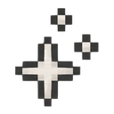

#  Welcome to my profile 

###  About me 
I love simple/modern design with an liking in both frosted and liquid glass design.

Whilst I enjoy developing software, I prefer to develop for a specific purpose.

Throughout my design and development process I continually ask myself:
"Would someone genuinely find this useful and want to use it?"

I aim to design beginner-friendly and useful software, functional and well designed.

###  Projects 

[Reflux](https://github.com/meowspiderr/Reflux) — A simple Windows 11 app for easy audio editing. Drop an audio file in any format and edit the bass, vocal presence, audio quality, length, and much more!

###  Languages & Tools 

  

  

<!--
<picture>
  <source media="(prefers-color-scheme: dark)" srcset="https://raw.githubusercontent.com/meowspiderr/meowspiderr/output/github-snake-dark.svg" />
  <source media="(prefers-color-scheme: light)" srcset="https://raw.githubusercontent.com/meowspiderr/meowspiderr/output/github-snake.svg" />
  
</picture>
-->
